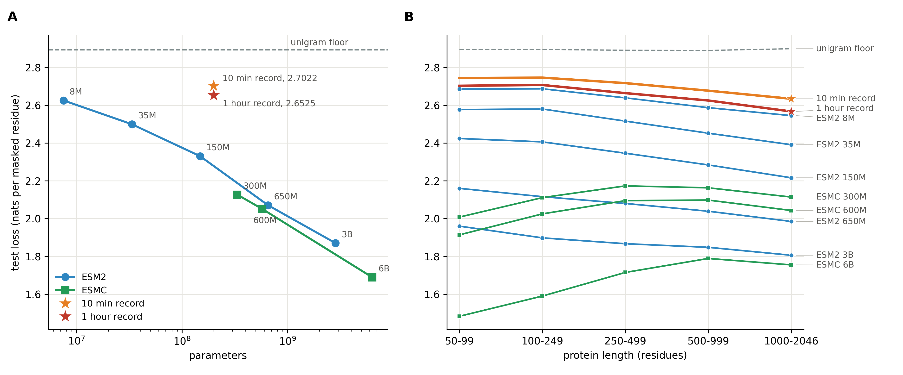

# SpeedrunningPLMs

**How good a protein masked language model can one GPU train against a fixed clock, and what makes it better?**

This is a fixed benchmark and a searched training recipe, in the spirit of
[modded-nanogpt](https://github.com/KellerJordan/modded-nanogpt). The data, objective, clock, evaluator and model shape
never change. A candidate is a genome: a JSON file choosing from families of composable modules. A search proposes
genomes, an agent adds new modules, and every run is recorded with its verdict.

## Records

| Track | Training clock | Test loss | `val_select` | Genome |
|---|---|---|---|---|
| 10 minutes | 600 s | **2.7022** | 2.7097 | [`auto01_bayes_02`](genomes/auto01_bayes_02.json) |
| 1 hour | 3,600 s | **2.6525** | 2.6625 | [`h_auto11_bayes_01`](genomes/h_auto11_bayes_01.json) |

Losses are cross entropy in nats per masked residue, lower is better. On the same masked residues the unigram floor
scores 2.8933, ESM2 8M 2.6253 and ESMC 6B 1.6891; those reference models trained for days on data holding relatives of
the held-out families, so they are an upper bound, not a fair race. The search windows closed on 2026-10-31 and
2026-11-02. See [`results.md`](results.md) for every record, reference score and lesson.



**A.** Test loss against parameters: both records sit above the reference curves near 199M parameters. **B.** Test loss
by protein length: the records and ESM2 lose less on long proteins, ESMC more.

## The benchmark in brief

- **Data:** [`Synthyra/SpeedrunningPLMs`](https://huggingface.co/datasets/Synthyra/SpeedrunningPLMs), 1,754,034
  AlphaFold DB training proteins. No held-out protein has a training relative at 30 percent identity over 80 percent
  coverage, by sequence or by structure.
- **Objective:** predict the 15 percent of standard residues replaced by MASK.
- **Clock:** applied training steps on one GPU, with compile warmup and in-run validation capped and outside the clock.
- **Shape:** 36 blocks, 768 wide, MLP 2,048. Heads, attention variants, normalization, tables and the optimizer are free.
- **Selection:** the weights with the lowest `val_select` loss are scored once on validation and test.

The full rules are in [`program.md`](program.md).

## Where to find things

| You want | Go to |
|---|---|
| Every record, reference score, hand-run candidate and lesson | [`results.md`](results.md) |
| The full rules, the search and how to run the loop | [`program.md`](program.md) |
| The short brief for coding agents | [`AGENTS.md`](AGENTS.md) |
| Every module family, its variants and evidence, and the untried ideas | [`ideas/README.md`](ideas/README.md) |
| The literature behind the ideas | the other files in `ideas/` |
| How the Python is written | [`CODING_STANDARDS.md`](CODING_STANDARDS.md) |

## Code map

| Path | What it is | Change it? |
|---|---|---|
| `src/speedrunning_plms/benchmark/` | data, tokens, evaluator, clock, shape rule, result schema, probe | only in a deliberate commit of its own |
| [`prepare.py`](prepare.py), [`baselines.py`](baselines.py), [`probe.py`](probe.py), [`record.py`](record.py), [`plots.py`](plots.py) | benchmark data, reference models, 3Di probe, campaign ledger, figures | only in a deliberate commit of its own |
| [`summary_plot.py`](summary_plot.py) | the comparison figure above, drawn from the tables of `results.md` | yes |
| `src/speedrunning_plms/strategies/` | one module per family a genome chooses from, and the registry | yes: a new idea is a new module |
| `genomes/` | genomes of note, the records among them | yes |
| [`train.py`](train.py) | the skeleton and training loop that builds a genome; with no genome it is candidate 022 | rarely |
| [`search.py`](search.py) | the screening, Bayesian and genetic proposers, shipping and collection | yes |
| [`autosearch.py`](autosearch.py), [`autosearch.sh`](autosearch.sh) | the unattended search loop | yes |
| [`run_gh200.sh`](run_gh200.sh), [`queue.sh`](queue.sh) | the Docker entrypoint on the GPU machine, and back-to-back runs | yes |
| `candidates/` | each record holder's `train.py` from before the search | no: frozen snapshots |
| `src/speedrunning_plms/optim/` | the per-matrix Muon the banked one is checked against | rarely |
| `tests/` | CPU tests of the fixed parts, modules, genomes, proposers and the record's reproduction | yes |

## Run it

Python 3.12 or newer. The CPU tests take a few minutes:

```bash
pip install -e ".[test]"
python -m pytest -q
```

A run on a GPU machine goes through Docker. Start with the 60 s pilot, which reports step time, compile time and memory:

```bash
bash run_gh200.sh build
HF_TOKEN=... bash run_gh200.sh prepare
bash run_gh200.sh pilot
bash run_gh200.sh train --name my_run --hypothesis "what this run tests" --genome genomes/auto01_bayes_02.json
```

Each run writes `result.json` (metrics, clock receipts, selection curve, digests) and `best.pt` (the selected weights).
The commands for the search loop are in [`program.md`](program.md).

## Contribute

A contribution is a module or a genome. A module is one file under `src/speedrunning_plms/strategies/`, listed in the
registry; the tests then build it, check the shape rule and train a CPU step on it. A genome is a run on the clock with
its verdict recorded. [`program.md`](program.md) has the steps, and untried ideas are in
[`ideas/README.md`](ideas/README.md).

## License

MIT.
