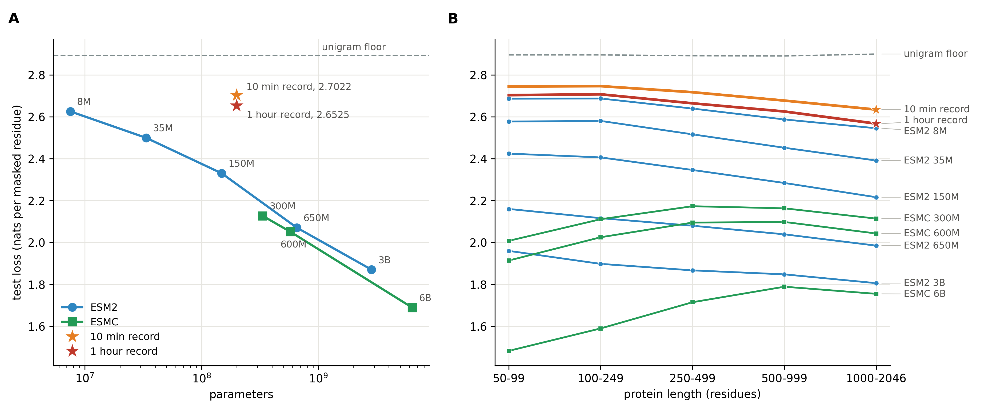
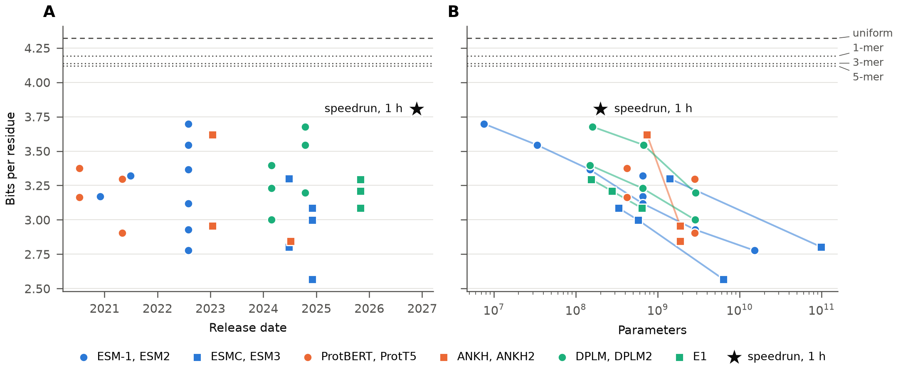

# SpeedrunningPLMs

**How good a protein masked language model can one GPU train against a fixed clock, and what makes it better?**

This is a fixed benchmark and a searched training recipe, in the spirit of
[modded-nanogpt](https://github.com/KellerJordan/modded-nanogpt). The data, objective, clock and evaluator never
change; since 2026-11-23 the model's shape is free as well, so one GH200 hour is the only budget and the 1-hour track is
the headline. A candidate is a genome: a JSON file choosing from families of composable modules, the shape among them.
A search (genetic children ranked by a Gaussian process) proposes genomes, an agent adds new modules, and every run is
recorded with its verdict.

## Records

| Track | Training clock | Test loss | `val_select` | Genome |
|---|---|---|---|---|
| 10 minutes | 600 s | **2.7022** | 2.7097 | [`auto01_bayes_02`](genomes/auto01_bayes_02.json) |
| 1 hour | 3,600 s | **2.6525** | 2.6625 | [`h_auto11_bayes_01`](genomes/h_auto11_bayes_01.json) |

Losses are cross entropy in nats per masked residue, lower is better. On the same masked residues the unigram floor
scores 2.8933, ESM2 8M 2.6253 and ESMC 6B 1.6891; those reference models trained for days on data holding relatives of
the held-out families, so they are an upper bound, not a fair race. The search windows closed on 2026-10-31 and
2026-11-02. [`results.md`](results.md) holds every record, reference score and lesson; `tests/test_documents.py`
checks that this table agrees with it.

**A.** Test loss against parameters: both records sit above the reference curves near 199M parameters. **B.** Test loss
by protein length: the records and ESM2 lose less on long proteins, ESMC more.

## New proteins, in bits per residue

OpenAI follows its models on one held-out code set by log-perplexity
([Perplexity and intelligence](https://openai.com/index/perplexity-and-intelligence/), 2026-11-22). The protein version
below scores 28 popular protein language models and the 1-hour record on 2,000 proteins that first entered UniProtKB in
release 2026_04, months after every one of the models was public, and the record's star moves whenever the record does.

**A.** Bits per residue against each model's first public release. **B.** The same against parameters, the sizes of one
model joined. The star is the 1-hour record, the dashed line uniform guessing over the 20 residues, and the dotted lines
lookup tables counted on the speedrun's training data that predict the masked residue from 0, 1, or 2 residues on
each side.

ESMC 6B leads at 2.567 bits per residue, and the record reads 3.805, behind ESM2 8M's 3.699 and ahead of the 5-mer
table's 4.120. Each protein is one uniformly drawn member of one of 2,000 uniformly drawn clusters (MMseqs2, 30% identity
over 80% coverage), so no family counts twice and a cluster's representative is no likelier than its other members.
Eight residues of each are masked one at a time, and the model's probability of the true residue, renormalized over
the 20 standard residues, gives the bits. The input formats of the T5 models and DPLM2's track layout were chosen on a
separate 100-protein dev set. The other models trained on large sequence databases such as UniRef, which hold
relatives of many of these proteins, while the record trained for one hour on AFDB v6 alone, without the 2 training
proteins that are exact copies of benchmark proteins, and 1,203 of the 2,100 benchmark proteins still have a relative
in its training data at 30% identity over half of either sequence. ANKH3 large and XL are scored but left out. With
the authors' own likelihood code, ANKH3 XL reads 3.58 bits with one masked residue and 2.97 with 15% of residues masked
at once, the condition it trained under, so the one-mask rule misreads it, and ANKH3 large stays near uniform under
either.
[`perplexity.py`](perplexity.py) builds the corpus, scores the models, and draws the figure.

Every point

| Model | Released | Parameters | Bits per residue | 95% CI |
|---|---|---|---|---|
| ESMC 6B | 2024-12-04 | 6.4B | 2.567 | 2.515 to 2.619 |
| ESM2 15B | 2022-08 | 15.1B | 2.777 | 2.730 to 2.825 |
| ANKH2 large (sentinel, `<extra_id_0>`) | 2024-07-07 | 1.9B | 2.845 | 2.797 to 2.892 |
| ProtT5-XL-U50 (bart, `<extra_id_0>`) | 2021-05-04 | 2.8B | 2.905 | 2.859 to 2.953 |
| ESM2 3B | 2022-08 | 2.8B | 2.929 | 2.884 to 2.973 |
| ANKH large (sentinel, `<extra_id_0>`) | 2023-01-16 | 1.9B | 2.956 | 2.908 to 3.002 |
| ESMC 600M | 2024-12-04 | 575M | 2.999 | 2.955 to 3.043 |
| DPLM 3B | 2024-02-28 | 2.8B | 3.001 | 2.958 to 3.043 |
| ESMC 300M | 2024-12-04 | 333M | 3.085 | 3.042 to 3.127 |
| E1 600M | 2025-11 | 641M | 3.085 | 3.041 to 3.128 |
| ESM2 650M | 2022-08 | 651M | 3.119 | 3.078 to 3.161 |
| ProtBERT | 2020-07-12 | 420M | 3.163 | 3.117 to 3.208 |
| ESM-1b | 2020-12 | 652M | 3.169 | 3.129 to 3.209 |
| DPLM2 3B (aa only) | 2024-10-17 | 2.9B | 3.196 | 3.156 to 3.236 |
| E1 300M | 2025-11 | 274M | 3.210 | 3.170 to 3.249 |
| DPLM 650M | 2024-02-28 | 651M | 3.229 | 3.190 to 3.266 |
| E1 150M | 2025-11 | 154M | 3.294 | 3.255 to 3.331 |
| ProtT5-XL-BFD (bart, `<extra_id_0>`) | 2021-05-04 | 2.8B | 3.297 | 3.253 to 3.339 |
| ESM3 open | 2024-06-25 | 1.4B | 3.299 | 3.261 to 3.338 |
| ESM-1v | 2021-07 | 652M | 3.320 | 3.281 to 3.358 |
| ESM2 150M | 2022-08 | 148M | 3.365 | 3.328 to 3.401 |
| ProtBERT-BFD | 2020-07-12 | 420M | 3.375 | 3.332 to 3.413 |
| DPLM 150M | 2024-02-28 | 148M | 3.398 | 3.362 to 3.433 |
| DPLM2 650M (aa only) | 2024-10-17 | 672M | 3.544 | 3.509 to 3.579 |
| ESM2 35M | 2022-08 | 34M | 3.545 | 3.512 to 3.576 |
| ANKH base (sentinel, `<extra_id_0>`) | 2023-01-16 | 736M | 3.620 | 3.577 to 3.668 |
| DPLM2 150M (aa only) | 2024-10-17 | 159M | 3.678 | 3.647 to 3.707 |
| ESM2 8M | 2022-08 | 8M | 3.699 | 3.668 to 3.729 |
| **speedrun, 1 h** (`h_auto11_bayes_01_minus_2026_04`) | 2026-11-23 | 199M | 3.805 | 3.778 to 3.833 |
| 5-mer lookup table (reference) | | | 4.120 | 4.105 to 4.134 |
| 3-mer lookup table (reference) | | | 4.139 | 4.127 to 4.151 |
| 1-mer lookup table (reference) | | | 4.192 | 4.181 to 4.202 |

## The benchmark in brief

- **Data:** [`Synthyra/SpeedrunningPLMs`](https://huggingface.co/datasets/Synthyra/SpeedrunningPLMs), 1,754,034
  AlphaFold DB training proteins. No held-out protein has a training relative at 30% identity over 80% coverage, by
  sequence or by structure.
- **Objective:** predict the 15% of standard residues replaced by MASK.
- **Clock:** applied training steps on one GH200, with compile warmup and in-run validation capped and outside the
  clock.
- **Shape:** free, and priced by the clock: depth, width and MLP width are genome numbers (the records ran 36 blocks,
  768 wide, MLP 2,048), as are looped cores, routing, heads, attention variants, normalization, tables and the
  optimizer. In-run evals must fit their cap, which bounds the compute a forward may spend.
- **Selection:** the weights with the lowest `val_select` loss are scored once on validation and test.

## Start here

| You want to | Read |
|---|---|
| install, run the tests, smoke a genome on a CPU, add a module, run on a GH200, submit a record attempt | [`CONTRIBUTING.md`](CONTRIBUTING.md) |
| the full rules, the files a change may touch, the hook reference and the search | [`program.md`](program.md) |
| every record, reference score, hand-run candidate and lesson | [`results.md`](results.md) |
| every module family, its variants and evidence, and the untried ideas | [`ideas/README.md`](ideas/README.md) |
| how the Python is written | [`CODING_STANDARDS.md`](CODING_STANDARDS.md) |
| the brief for coding agents | [`AGENTS.md`](AGENTS.md) |

Outside collaborators may submit record attempts they ran on their own GH200, with the run's evidence; the steps are
in [`CONTRIBUTING.md`](CONTRIBUTING.md#submit-a-record-attempt).

## Code map

Which of these are fixed, and when `train.py` may change, is stated in
[`program.md`](program.md#what-a-change-may-touch).

| Path | What it is |
|---|---|
| `src/speedrunning_plms/benchmark/` | the fixed benchmark: data, tokens, evaluator, clock, architecture receipt, result schema, probe |
| [`prepare.py`](prepare.py), [`baselines.py`](baselines.py), [`baselines.json`](baselines.json), [`probe.py`](probe.py), [`record.py`](record.py), [`plots.py`](plots.py) | the fixed scripts: benchmark data, reference models and their scores, 3Di probe, campaign ledger, figures |
| `src/speedrunning_plms/strategies/` | one module per family a genome chooses from, the strategy interface (`strategy.py`) and the registry |
| `src/speedrunning_plms/optim/` | the per-matrix Muon the banked one is checked against |
| [`src/speedrunning_plms/evidence.py`](src/speedrunning_plms/evidence.py) | the run evidence `train.py` writes beside each result |
| `src/foundry/` | the `foundry` library modules the code imports (cross entropy, logging, pilot, run provenance), vendored into the GitHub repository |
| [`train.py`](train.py) | the skeleton and training loop that builds a genome; with no genome it is candidate 022 |
| [`dial.py`](dial.py) | a looped run's selected weights scored at each pass count and exit, with routing and SGLR route statistics, written outside the run folder |
| `genomes/` | genomes of note, the records among them |
| [`search.py`](search.py) | the proposers (screening, Bayes, genetic, random, manual and two in a head-to-head), shipping and collection |
| [`search_space.py`](search_space.py) | the search's catalog: what a genome may vary, the screening switches, compile costs |
| [`tabular_surrogate.py`](tabular_surrogate.py), [`Dockerfile.kumo`](Dockerfile.kumo) | Kumo Tabular behind `--proposer kumo`, and its image |
| [`autosearch.py`](autosearch.py), [`autosearch.sh`](autosearch.sh) | the unattended search loop |
| [`run_gh200.sh`](run_gh200.sh), [`queue.sh`](queue.sh), [`Dockerfile`](Dockerfile) | the Docker entrypoint on the GPU machine, back-to-back runs, the image |
| [`verify_run.py`](verify_run.py) | checks a run folder submitted for a record: PASS, FAIL or REVIEW |
| [`tiny_data.py`](tiny_data.py) | the tiny synthetic data directory for CPU smokes and the tests |
| [`summary_plot.py`](summary_plot.py) | the comparison figure above, drawn from the tables of `results.md` |
| [`publish_dataset.py`](publish_dataset.py), [`publish_runs.py`](publish_runs.py) | put the benchmark data, and a campaign's runs and search state, on the Hugging Face Hub |
| `candidates/` | each record holder's `train.py` from before the search: frozen snapshots |
| `tests/` | CPU tests of the fixed parts, modules, genomes, proposers, run evidence, the record's reproduction and these documents |

## License

MIT.
