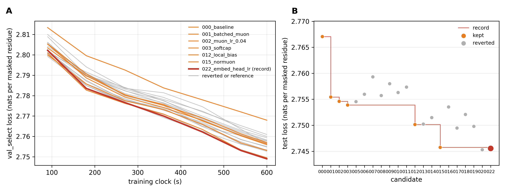
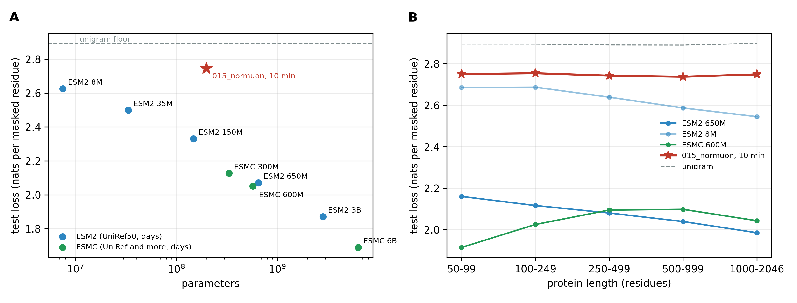

# SpeedrunningPLMs

**How good a protein masked language model can one GPU train in ten minutes, and what makes it better?**

A fixed benchmark and one editable file, in the spirit of [modded-nanogpt](https://github.com/KellerJordan/modded-nanogpt):
the data, the objective, the clock, the evaluator and the shape rule are fixed; `train.py` holds everything a run may
change. A candidate is kept when it lowers the selection loss of the incumbent, every run carries the digests of the
data, the evaluator and the candidate that produced it, and every record holder's `train.py` is snapshotted under
`candidates/`.

## The record

| # | Test loss (nats) | Bits | `val_select` | Steps | What changed | Candidate |
|---|---|---|---|---|---|---|
| 0 | 2.7671 | 3.992 | 2.7680 | 1,412 | the baseline: pre-norm 36 x 768, RoPE, QK-norm, ReLU-squared MLP, flex attention with a document mask over packed 1,024-token windows, per-matrix Muon with Polar Express, AdamW on the tables, warmup and a 40 percent cooldown by clock fraction | [`000_baseline.py`](candidates/000_baseline.py) |
| 1 | 2.7554 | 3.975 | 2.7570 | 2,157 | Muon banked by parameter shape: one batched Polar Express per shape instead of 216 per-matrix calls (the host had been 76 percent of the step) | [`001_batched_muon.py`](candidates/001_batched_muon.py) |
| 2 | 2.7546 | 3.974 | 2.7564 | 2,161 | Muon learning rate 0.02 to 0.04 | [`002_muon_lr_0.04.py`](candidates/002_muon_lr_0.04.py) |
| 3 | 2.7539 | 3.973 | 2.7559 | 2,157 | tanh logit softcap at 30 | [`003_softcap.py`](candidates/003_softcap.py) |
| 4 | 2.7501 | 3.968 | 2.7531 | 2,059 | a fixed ALiBi-style local bias on the attention scores beside RoPE, per-head slopes 2^(-8 i / h): every head is local from step 0 | [`012_local_bias.py`](candidates/012_local_bias.py) |
| 5 | 2.7457 | 3.961 | 2.7495 | 2,051 | NorMuon: the orthogonalized update normalized per output neuron by an EMA of its mean square, rescaled to the Muon norm (confirmed at seeds 1 and 2: 2.7447 and 2.7437) | [`015_normuon.py`](candidates/015_normuon.py) |
| 6 | **2.7455** | 3.961 | 2.7490 | 2,055 | embedding lr 3e-3 and head lr 1e-3, three times the tables' rates; kept by the rule, inside one seed's band | [`022_embed_head_lr.py`](candidates/022_embed_head_lr.py) |



**A.** The `val_select` loss of every seed-0 candidate against the training clock: kept candidates in orange, the
record holder in red, reverted candidates in gray. **B.** The test loss of every candidate in the order tried, with the
record as a step line. One seed resolves about 0.0015 nats (the NorMuon record at seeds 0, 1 and 2: 2.7457, 2.7447
and 2.7437 on test), so a gain inside that band is kept by the rule but not claimed.

The hardware of record is one NVIDIA GH200 (the H100 die, 96 GB HBM3). A run on other hardware is a different clock
and is recorded as such.

## Where it stands



**A.** Test loss against parameters for the record holder (red star) and the reference models, every model scored on
its own 20 residue columns on the same masked positions; the unigram floor is the loss of predicting the training
residue frequencies. **B.** Test loss by protein length: the ten-minute model is flat across lengths while the
reference models gain on long proteins, so use of context is what the short clock has not yet bought.

| Model | Parameters | `val_select` | Validation | Test loss | Bits | Accuracy | F1 macro | MCC | ROC AUC | PR AUC |
|---|---|---|---|---|---|---|---|---|---|---|
| unigram floor | | 2.8934 | 2.8938 | 2.8933 | 4.174 | 0.098 | 0.009 | 0.000 | 0.500 | 0.050 |
| **record, 10 min** | 198,231,552 | 2.7490 | 2.7465 | 2.7455 | 3.961 | 0.146 | 0.102 | 0.078 | 0.652 | 0.104 |
| ESM2 8M | 7,523,034 | 2.6393 | 2.6291 | 2.6253 | 3.788 | 0.186 | 0.157 | 0.124 | 0.695 | 0.157 |
| ESM2 35M | 33,517,234 | 2.5164 | 2.4965 | 2.4992 | 3.606 | 0.225 | 0.206 | 0.168 | 0.735 | 0.208 |
| ESM2 150M | 148,161,274 | 2.3490 | 2.3176 | 2.3303 | 3.362 | 0.275 | 0.267 | 0.224 | 0.780 | 0.275 |
| ESM2 650M | 651,085,494 | 2.0971 | 2.0534 | 2.0710 | 2.988 | 0.354 | 0.355 | 0.309 | 0.836 | 0.380 |
| ESM2 3B | 2,839,090,114 | 1.8921 | 1.8537 | 1.8705 | 2.699 | 0.416 | 0.422 | 0.376 | 0.871 | 0.460 |
| ESMC 300M | 332,997,184 | 2.1463 | 2.1118 | 2.1269 | 3.068 | 0.339 | 0.337 | 0.293 | 0.824 | 0.359 |
| ESMC 600M | 575,036,992 | 2.0676 | 2.0304 | 2.0510 | 2.959 | 0.361 | 0.363 | 0.317 | 0.838 | 0.390 |
| ESMC 6B | 6,352,005,184 | 1.7061 | 1.6617 | 1.6891 | 2.437 | 0.472 | 0.480 | 0.437 | 0.897 | 0.531 |

The reference models trained for days on UniRef50 and more, which holds relatives of the held-out families; they
bound the benchmark from above, they are not a fair race. The ten-minute model sees about 135M tokens, a third of
one pass over the training stream, so no protein is seen twice.

## Everything tried

Candidates are tried one at a time on the incumbent; a candidate is kept when its `val_select` loss is lower. The
ranked queue, with the evidence behind each idea, is [`ideas/README.md`](ideas/README.md); the literature notes it draws
on sit beside it.

| # | Change | Verdict | `val_select` | Test |
|---|---|---|---|---|
| 000 | the baseline | incumbent | 2.7680 | 2.7671 |
| 001 | Muon banked by parameter shape (1.53 times the steps) | kept | 2.7570 | 2.7554 |
| 002 | Muon lr 0.04 | kept, within noise | 2.7564 | 2.7546 |
| 003 | tanh logit softcap at 30 | kept, within noise | 2.7559 | 2.7539 |
| 004 | the incumbent at seed 1 | reference: one seed resolves about 0.0015 nats | 2.7574 | 2.7551 |
| 005 | U-net skips with learned scalars | reverted | 2.7568 | 2.7545 |
| 006 | weight EMA (decay 0.995) over the cooldown | reverted: led mid-cooldown, lagged at the end | 2.7578 | 2.7560 |
| 007 | learnable exclusive self-attention | reverted: 4 percent fewer steps, behind throughout | 2.7610 | 2.7593 |
| 008 | 32 windows a step | reverted: 1.8 times the steps, ahead at 90 s, behind from 180 s | 2.7579 | 2.7557 |
| 009 | 512-token windows, 128 a step | reverted: 6 percent more steps, long proteins lose | 2.7600 | 2.7580 |
| 010 | a (left, right) neighbor-pair table added to the embedding | reverted | 2.7583 | 2.7563 |
| 011 | zero-initialized value embeddings on blocks 0 to 2 and 33 to 35 | reverted | 2.7594 | 2.7573 |
| 012 | a fixed ALiBi-style local bias on every head beside RoPE | kept: ahead at every eval from 90 s | 2.7531 | 2.7501 |
| 013 | one protein per family per pass (family-balanced order) | reverted: the same curve; the budget is not family-limited | 2.7532 | 2.7502 |
| 014 | the local bias on six heads, six free | reverted: loses most of 012's gain | 2.7548 | 2.7515 |
| 015 | NorMuon | kept: ahead from 180 s | 2.7495 | 2.7457 |
| 016 | cautious weight decay 0.1 on the block matrices | reverted: behind from 180 s | 2.7564 | 2.7535 |
| 017 | embedding lr 3e-3, head lr 1e-3 | reverted: within noise of 015 | 2.7527 | 2.7495 |
| 018 | Muon lr 0.06 | reverted: behind from 270 s | 2.7551 | 2.7521 |
| 019 | cooldown over the last 60 percent of the clock | reverted: within noise of 015 | 2.7534 | 2.7498 |
| 015 s1, s2 | the record at seeds 1 and 2 | reference: three-seed test mean 2.7447, span 0.002 | 2.7482, 2.7480 | 2.7447, 2.7437 |
| 020 | mimetic V and O initialization (W_O W_V = 0.25 I at the start) | reverted: the same curve | 2.7496 | 2.7453 |
| 021 | the local-bias slopes learned per head inside the flex attention score function | invalid: compile warmup 264 s against the 180 s cap, then 28 s a step | | |
| 022 | embedding lr 3e-3, head lr 1e-3, on 015 | kept by the rule: lower by 0.0005, as it was on 012 | 2.7490 | 2.7455 |
| pilot | the MLP's matmuls in FP8 (`torch._scaled_mm`, per-tensor scales) | not run: 0.284 s a step against 0.276 in bf16 | | |

What the campaign has learned so far:

- **The step is GPU-bound at 0.276 s.** After the banked Muon, a profile puts matmuls at 109 ms near the bf16 peak,
  flex attention at 80 ms, Muon at 26 ms and the host idle. More steps now come from attention or from precision,
  not from the host; FP8 did not pay at width 768.
- **Context use is the open gap.** The test loss of the ten-minute model is flat from 50 to 2,046 residues, 0.15 nats
  under the unigram floor; the reference models gain most on long proteins. A local prior on attention (012) was the
  first change beyond noise after the optimizer, and freeing half the heads (014) gave most of it back.
- **The budget is not family-limited.** Covering every training family in the first half of the clock (013) gave
  the same curve as the shuffled stream.
- **The optimizer's fine settings are inside the noise.** Three times the table rates (022) and a longer cooldown
  (019) moved `val_select` by 0.0005 or less; the Muon rate past 0.04 (018) and cautious decay (016) lost 0.003 to
  0.007. The record's three seeds span 0.002 on test.
- **A learnable tensor inside the flex attention score function is not free.** Slopes as parameters (021) put the
  kernel on a path a hundred times slower (28 s a step) and broke the compile cap; the fixed slopes keep the gain.
- **Structure follows.** A probe from the hidden states to Foldseek 3Di states (reported, never selected on) reaches
  test accuracy 0.367 and MCC 0.245 on the NorMuon record, against 0.384 and 0.266 for ESM2 8M and 0.514 and 0.437
  for ESMC 6B through the same probe.

## The benchmark

| Rule | What it is |
|---|---|
| Data | [`Synthyra/SpeedrunningPLMs`](https://huggingface.co/datasets/Synthyra/SpeedrunningPLMs): 1,754,034 training proteins (392.6M tokens) from the AlphaFold DB family split of the Alignment Atlas, 25,459 validation and 25,778 test proteins. No held-out protein has a training relative at 30 percent identity over 80 percent coverage by sequence (MMseqs2) or by structure (Foldseek). Lengths 50 to 2,046 residues. ESM2 alphabet. |
| Objective | 15 percent of standard residues replaced by MASK, nothing else; collapse-free cross entropy ([arXiv 2610.31642](https://arxiv.org/abs/2610.31642)) on the masked residues over the 20 standard residues. Training uses the same corruption. |
| Clock | 10 minutes of applied training steps on one GPU, measured with device synchronization; the overrunning step is discarded. Compile warmup is outside the clock, capped at 3 minutes; in-run validation is outside the clock, capped at 60 seconds in total. A broken cap makes the run `invalid`. |
| Selection | The weights with the lowest loss on `val_select` (one protein per validation family, 4,751 proteins, at most 1,024 tokens, fixed masks) are scored once on the full validation and test splits at full length (at most 2,048 tokens, fixed masks). The headline is the test loss, in nats per masked residue. |
| Shape | 36 blocks on a 768-wide residual stream, each one attention sublayer and one MLP with intermediate 2,048 (about 198M parameters with the embedding and head). Heads, grouped or differential attention, biases, value embeddings, skips, gates, scalars, normalization, tables and the optimizer are free. The shape is checked on every run. |
| Metrics | Loss, bits, perplexity, accuracy, macro and weighted precision, recall and F1, MCC, macro ROC AUC and PR AUC, loss by length bin; every model scored on its own 20 residue columns, so ESM2 (33 tokens) and ESMC (64 tokens) are scored on the same problem. |
| Structure probe | A softmax-weighted sum of all hidden states (each RMS-normalized), then one linear layer to the 20 Foldseek 3Di states, trained on 20,000 training proteins and scored on validation and test. Reported, never used for selection. |
| Seeds | The search runs at seed 0 and keeps single-seed wins; a record is confirmed at seeds 1 and 2 at milestones. |

## Running

```bash
pip install -e ".[test]"
python -m pytest -q                      # CPU tests of every fixed part, a few minutes
bash run_gh200.sh build                  # the image (CUDA 12.8, torch 2.11; aarch64 or x86_64)
HF_TOKEN=... bash run_gh200.sh prepare   # the data, once per machine
bash run_gh200.sh pilot                  # a 60 s clock: step time, compile time, memory
bash run_gh200.sh train --name 000_baseline --hypothesis "the baseline"
bash run_gh200.sh probe --run-dir /state/runs/000_baseline
bash run_gh200.sh baselines              # the reference models through the same evaluator and probe
bash queue.sh                            # every candidates/queue/<name>.py back to back
```

A run writes `result.json` (the metrics, the clock and architecture receipts, the selection curve, the digests) and
`best.pt` (the selected weights). `record.py` appends a run to a campaign ledger with its verdict; `plots.py` draws
the figures above from the ledger and the result files. `program.md` is the brief an agent follows to run the loop.

## Contributing

A contribution is a candidate: one change to `train.py`, a one-sentence hypothesis, a run on the clock, and the
verdict recorded. `AGENTS.md` is the short form of the loop; `CODING_STANDARDS.md` is how the Python is written
(import order, precise types, intent comments, a shape trace on every tensor line), and `python -m pytest -q` checks
the fixed parts and the working candidate on the CPU. The benchmark modules change only with a reason, in their own
commit.

## Layout

```
train.py             the candidate: model, optimizer, loop; the one file a run edits
candidates/          every record holder's train.py, and candidates/queue/ for the next shipment
ideas/               the ranked queue of what to try and the literature it rests on
prepare.py           builds the benchmark data from the source dataset
baselines.py         the reference models through the same evaluator and probe
probe.py             the 3Di probe on a run's selected weights
record.py, plots.py  the campaign ledger and its figures
run_gh200.sh         the Docker entrypoint on the GPU machine; queue.sh runs queued candidates
program.md           the brief an agent follows; AGENTS.md its short form; CODING_STANDARDS.md how the Python is written
src/speedrunning_plms/benchmark/   data, tokens, evaluator, clock, shape rule, result schema, probe (fixed)
src/speedrunning_plms/optim/       the per-matrix Muon (Newton-Schulz or Polar Express) the candidate's banked one is checked against
tests/               CPU tests of every fixed part and of the candidate
```

## License

MIT.
