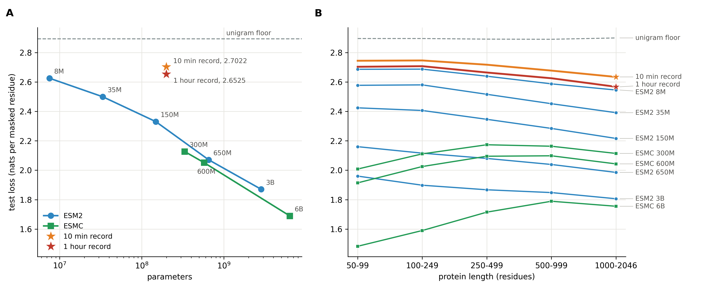
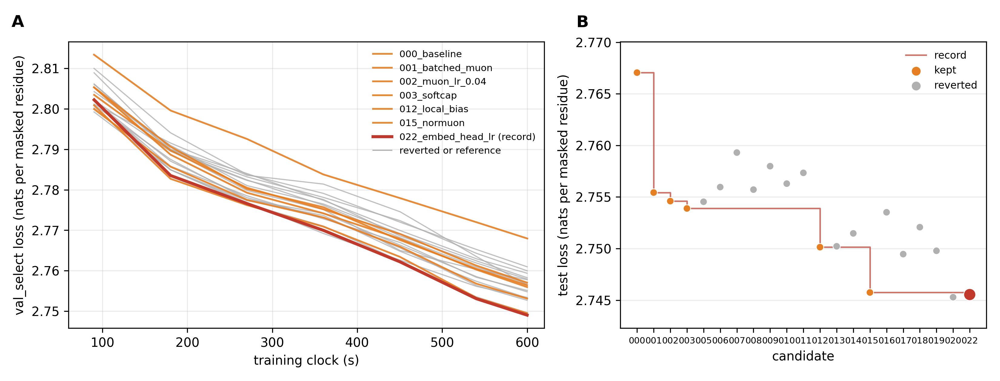
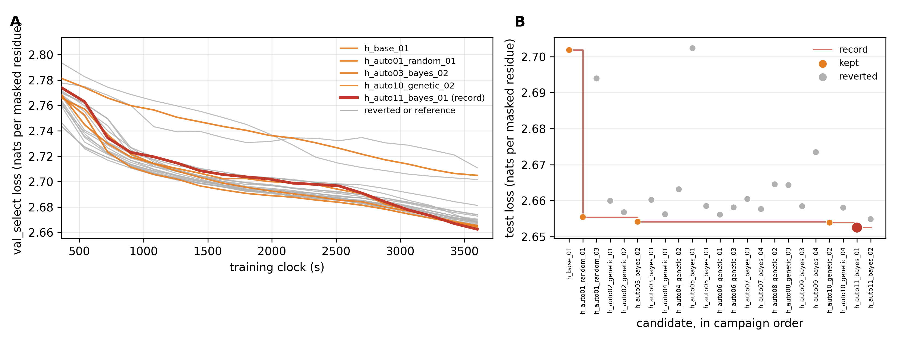

# Results

Every record, reference score and hand-run candidate of the AFDB v6 speedrun, and what each track learned. The rules
behind these numbers are in [`program.md`](program.md); the evidence for each module is in
[`ideas/README.md`](ideas/README.md).

Losses are cross entropy in nats per masked residue, lower is better. A run keeps the weights with the lowest
`val_select` loss, and the test loss of those weights is the headline. All runs used one NVIDIA GH200 (the H100 die,
96 GB HBM3); a run on other hardware is a different clock and is recorded as such.

## Contents

- [Reference models](#reference-models)
- [10-minute track](#10-minute-track): [records](#records), [hand-run candidates](#hand-run-candidates), [what it learned](#what-it-learned)
- [1-hour track](#1-hour-track)

## Reference models

**A.** Test loss against parameters. Both records sit near 199M parameters and above the reference curves: at 7.5M
parameters, ESM2 8M leads the 1-hour record by 0.027 nats and the 10-minute record by 0.077. **B.** Test loss by protein length. The records and every ESM2 model lose
less on long proteins (the 10-minute record by 0.110 and the 1-hour record by 0.136 from the shortest bin to the
longest), while every ESMC model loses more. Every model is scored on the same masked residues; the tables below hold
the plotted numbers, and `summary_plot.py` redraws the figure from them.

| Model | Parameters | `val_select` | Validation | Test loss | Bits | Accuracy | F1 macro | MCC | ROC AUC | PR AUC |
|---|---|---|---|---|---|---|---|---|---|---|
| unigram floor | | 2.8934 | 2.8938 | 2.8933 | 4.174 | 0.098 | 0.009 | 0.000 | 0.500 | 0.050 |
| **record, 10 min** | 198,485,028 | 2.7097 | 2.7058 | 2.7022 | 3.898 | 0.162 | 0.127 | 0.096 | 0.665 | 0.129 |
| **record, 1 hour** | 199,081,818 | 2.6625 | 2.6557 | 2.6525 | 3.827 | 0.178 | 0.148 | 0.115 | 0.685 | 0.148 |
| ESM2 8M | 7,523,034 | 2.6393 | 2.6291 | 2.6253 | 3.788 | 0.186 | 0.157 | 0.124 | 0.695 | 0.157 |
| ESM2 35M | 33,517,234 | 2.5164 | 2.4965 | 2.4992 | 3.606 | 0.225 | 0.206 | 0.168 | 0.735 | 0.208 |
| ESM2 150M | 148,161,274 | 2.3490 | 2.3176 | 2.3303 | 3.362 | 0.275 | 0.267 | 0.224 | 0.780 | 0.275 |
| ESM2 650M | 651,085,494 | 2.0971 | 2.0534 | 2.0710 | 2.988 | 0.354 | 0.355 | 0.309 | 0.836 | 0.380 |
| ESM2 3B | 2,839,090,114 | 1.8921 | 1.8537 | 1.8705 | 2.699 | 0.416 | 0.422 | 0.376 | 0.871 | 0.460 |
| ESMC 300M | 332,997,184 | 2.1463 | 2.1118 | 2.1269 | 3.068 | 0.339 | 0.337 | 0.293 | 0.824 | 0.359 |
| ESMC 600M | 575,036,992 | 2.0676 | 2.0304 | 2.0510 | 2.959 | 0.361 | 0.363 | 0.317 | 0.838 | 0.390 |
| ESMC 6B | 6,352,005,184 | 1.7061 | 1.6617 | 1.6891 | 2.437 | 0.472 | 0.480 | 0.437 | 0.897 | 0.531 |

Test loss by protein length (residues):

| Model | 50-99 | 100-249 | 250-499 | 500-999 | 1000-2046 |
|---|---|---|---|---|---|
| unigram floor | 2.895 | 2.895 | 2.891 | 2.890 | 2.899 |
| **record, 10 min** | 2.744 | 2.746 | 2.717 | 2.677 | 2.634 |
| **record, 1 hour** | 2.703 | 2.707 | 2.664 | 2.625 | 2.567 |
| ESM2 8M | 2.686 | 2.687 | 2.639 | 2.587 | 2.545 |
| ESM2 35M | 2.577 | 2.580 | 2.516 | 2.452 | 2.391 |
| ESM2 150M | 2.424 | 2.406 | 2.346 | 2.284 | 2.216 |
| ESM2 650M | 2.160 | 2.116 | 2.080 | 2.039 | 1.985 |
| ESM2 3B | 1.960 | 1.898 | 1.867 | 1.848 | 1.806 |
| ESMC 300M | 2.008 | 2.111 | 2.173 | 2.163 | 2.114 |
| ESMC 600M | 1.914 | 2.025 | 2.095 | 2.098 | 2.043 |
| ESMC 6B | 1.483 | 1.590 | 1.715 | 1.789 | 1.755 |

The reference models trained for days on UniRef50 and more, which holds relatives of the held-out families; they
bound the benchmark from above, they are not a fair race. The ten-minute model sees about 135M tokens, a third of
one pass over the training stream, so no protein is seen twice.

## 10-minute track

Run from 2026-10-28 to 2026-10-31 (163 ledger rows). The record is
[`genomes/auto01_bayes_02.json`](genomes/auto01_bayes_02.json): test loss 2.7022, `val_select` 2.7097.

### Records

| # | Test loss (nats) | Bits | `val_select` | Steps | What changed | Candidate |
|---|---|---|---|---|---|---|
| 0 | 2.7671 | 3.992 | 2.7680 | 1,412 | the baseline: pre-norm 36 x 768, RoPE, QK-norm, ReLU-squared MLP, flex attention with a document mask over packed 1,024-token windows, per-matrix Muon with Polar Express, AdamW on the tables, warmup and a 40 percent cooldown by clock fraction | [`000_baseline.py`](candidates/000_baseline.py) |
| 1 | 2.7554 | 3.975 | 2.7570 | 2,157 | Muon banked by parameter shape: one batched Polar Express per shape instead of 216 per-matrix calls (the host had been 76 percent of the step) | [`001_batched_muon.py`](candidates/001_batched_muon.py) |
| 2 | 2.7546 | 3.974 | 2.7564 | 2,161 | Muon learning rate 0.02 to 0.04 | [`002_muon_lr_0.04.py`](candidates/002_muon_lr_0.04.py) |
| 3 | 2.7539 | 3.973 | 2.7559 | 2,157 | tanh logit softcap at 30 | [`003_softcap.py`](candidates/003_softcap.py) |
| 4 | 2.7501 | 3.968 | 2.7531 | 2,059 | a fixed ALiBi-style local bias on the attention scores beside RoPE, per-head slopes 2^(-8 i / h): every head is local from step 0 | [`012_local_bias.py`](candidates/012_local_bias.py) |
| 5 | 2.7457 | 3.961 | 2.7495 | 2,051 | NorMuon: the orthogonalized update normalized per output neuron by an EMA of its mean square, rescaled to the Muon norm (confirmed at seeds 1 and 2: 2.7447 and 2.7437) | [`015_normuon.py`](candidates/015_normuon.py) |
| 6 | 2.7455 | 3.961 | 2.7490 | 2,055 | embedding lr 3e-3 and head lr 1e-3, three times the tables' rates; kept by the rule, inside one seed's band | [`022_embed_head_lr.py`](candidates/022_embed_head_lr.py) |
| 7 | 2.7291 | 3.937 | 2.7319 | 1,994 | a value residual: every block's values mixed with the first block's, V = a V_l + (1 - a) V_0 with a learned scalar a per block from 0.5 (ResFormer); the gain is on long proteins, 0.025 nats over 500 residues | [`028_value_residual.py`](candidates/028_value_residual.py) |
| 8 | 2.7175 | 3.921 | 2.7217 | 2,147 | the first screen's best row on 7: 6 heads of 128 instead of 12 of 64, value embeddings on blocks 0 to 2 and 33 to 35, no softcap, doubled local slopes, U-net skips and a tail weight average | [`screen1_05.json`](genomes/screen1_05.json) |
| 9 | 2.7119 | 3.912 | 2.7177 | 2,148 | the screen's five helpful switches together on 7: 6 heads of 128, value embeddings, RoPE base 100,000, unit selection (only the more active half of the MLP units get gradients each step) and no softcap | [`confirm1_01.json`](genomes/confirm1_01.json) |
| 10 | 2.7078 | 3.907 | 2.7146 | 2,149 | 9 with the shared-head readout warm start in place of unit selection: early in the run the head also reads the stream after every sixth block, so the blocks learn from a signal that does not wait for the end-to-end gradient; the Gaussian process proposed it and the single-switch batch found the same genome at 2.7147 | [`bayes2_01.json`](genomes/bayes2_01.json) |
| 11 | 2.7067 | 3.905 | 2.7133 | 2,104 | 10 with the third single-switch batch's three gains stacked: LN scaling (each block's normalized input scaled by 1/sqrt(block index + 1), arXiv 2502.05795), the sublayer outputs faded in over the first 10 percent of the clock, and a two-layer head; each alone was 0.0005 to 0.0009 under 10 on `val_select`, together 0.0013, all inside one seed's band and kept by the rule | [`single3_04.json`](genomes/single3_04.json) |
| 12 | **2.7022** | 3.898 | 2.7097 | 2,152 | the Gaussian process's first unattended batch on 11: the branch ramp and the two-layer head dropped, the local attention bias off, the readout warm start ending at 16.5 percent of the clock, proteins sampled by family size to the power -0.5 (ESM-2 reads clusters uniformly) and small neighbor-prediction heads at the masked residues (each predicts the residue at a fixed offset, scored like the main loss); 0.0036 under 11, more than twice the seed band | [`auto01_bayes_02.json`](genomes/auto01_bayes_02.json) |

**A.** The `val_select` loss of every seed-0 candidate against the training clock: kept candidates in orange, the
record holder in red, reverted candidates in gray. **B.** The test loss of every candidate in the order tried, with the
record as a step line. One seed resolves about 0.0015 nats (the NorMuon record at seeds 0, 1 and 2: 2.7457, 2.7447
and 2.7437 on test), so a gain inside that band is kept by the rule but not claimed.

### Hand-run candidates

The candidates tried one at a time on the incumbent before the search took over; a candidate is kept when its
`val_select` loss is lower. Search runs after 028 appear above only when they took the record; the full ledger stays
in the workspace.

| # | Change | Verdict | `val_select` | Test |
|---|---|---|---|---|
| 000 | the baseline | incumbent | 2.7680 | 2.7671 |
| 001 | Muon banked by parameter shape (1.53 times the steps) | kept | 2.7570 | 2.7554 |
| 002 | Muon lr 0.04 | kept, within noise | 2.7564 | 2.7546 |
| 003 | tanh logit softcap at 30 | kept, within noise | 2.7559 | 2.7539 |
| 004 | the incumbent at seed 1 | reference: one seed resolves about 0.0015 nats | 2.7574 | 2.7551 |
| 005 | U-net skips with learned scalars | reverted | 2.7568 | 2.7545 |
| 006 | weight EMA (decay 0.995) over the cooldown | reverted: led mid-cooldown, lagged at the end | 2.7578 | 2.7560 |
| 007 | learnable exclusive self-attention | reverted: 4 percent fewer steps, behind throughout | 2.7610 | 2.7593 |
| 008 | 32 windows a step | reverted: 1.8 times the steps, ahead at 90 s, behind from 180 s | 2.7579 | 2.7557 |
| 009 | 512-token windows, 128 a step | reverted: 6 percent more steps, long proteins lose | 2.7600 | 2.7580 |
| 010 | a (left, right) neighbor-pair table added to the embedding | reverted | 2.7583 | 2.7563 |
| 011 | zero-initialized value embeddings on blocks 0 to 2 and 33 to 35 | reverted | 2.7594 | 2.7573 |
| 012 | a fixed ALiBi-style local bias on every head beside RoPE | kept: ahead at every eval from 90 s | 2.7531 | 2.7501 |
| 013 | one protein per family per pass (family-balanced order) | reverted: the same curve; the budget is not family-limited | 2.7532 | 2.7502 |
| 014 | the local bias on six heads, six free | reverted: loses most of 012's gain | 2.7548 | 2.7515 |
| 015 | NorMuon | kept: ahead from 180 s | 2.7495 | 2.7457 |
| 016 | cautious weight decay 0.1 on the block matrices | reverted: behind from 180 s | 2.7564 | 2.7535 |
| 017 | embedding lr 3e-3, head lr 1e-3 | reverted: within noise of 015 | 2.7527 | 2.7495 |
| 018 | Muon lr 0.06 | reverted: behind from 270 s | 2.7551 | 2.7521 |
| 019 | cooldown over the last 60 percent of the clock | reverted: within noise of 015 | 2.7534 | 2.7498 |
| 015 s1, s2 | the record at seeds 1 and 2 | reference: three-seed test mean 2.7447, span 0.002 | 2.7482, 2.7480 | 2.7447, 2.7437 |
| 020 | mimetic V and O initialization (W_O W_V = 0.25 I at the start) | reverted: the same curve | 2.7496 | 2.7453 |
| 021 | the local-bias slopes learned per head inside the flex attention score function | invalid: compile warmup 264 s against the 180 s cap, then 28 s a step | | |
| 022 | embedding lr 3e-3, head lr 1e-3, on 015 | kept by the rule: lower by 0.0005, as it was on 012 | 2.7490 | 2.7455 |
| 023 | Muon momentum 0.95 from step 0, no warmup from 0.85 | reverted: lost 0.004 | 2.7527 | 2.7491 |
| 024 | RoPE base 100,000 | reverted: under 022 by 0.0011, inside the band, not under 028 from the same queue; retest on 028 | 2.7479 | 2.7443 |
| 025 | the local-bias slopes doubled | reverted: under 022 by 0.0005, inside the band; retest on 028 | 2.7485 | 2.7450 |
| 026 | per-head sigmoid attention gates from the residual's first h channels | reverted: lost 0.002 | 2.7510 | 2.7476 |
| 027 | 512-token windows for the first 40 percent of the clock, then 1,024 | invalid: two window shapes compiled twice, warmup 249 s against the 180 s cap; its 2.7479 does not count | | |
| 028 | a value residual to the first block's values, a learned scalar per block from 0.5 | kept: lower by 0.017, eleven times the band; 0.025 nats on proteins over 500 residues | 2.7319 | 2.7291 |
| pilot | the MLP's matmuls in FP8 (`torch._scaled_mm`, per-tensor scales) | not run: 0.284 s a step against 0.276 in bf16 | | |

### What it learned

- **The step is GPU-bound at 0.276 s.** After the banked Muon, a profile puts matmuls at 109 ms near the bf16 peak,
  flex attention at 80 ms, Muon at 26 ms and the host idle. More steps now come from attention or from precision,
  not from the host; FP8 did not pay at width 768.
- **Context use is the open gap, and the value residual opened it.** Through 022 the test loss of the ten-minute
  model was flat from 50 to 2,046 residues, 0.15 nats under the unigram floor, while the reference models gain most
  on long proteins. A local prior on attention (012) was the first change beyond noise after the optimizer, and
  freeing half the heads (014) gave most of it back. Mixing the first block's values into every block's (028) is
  the first gain that grows with length: 0.004 nats under 100 residues, 0.025 over 500.
- **The first screen found five gains on the value residual.** Twelve runs switching 11 modules on and off together
  (a Plackett-Burman design, standard error 0.0009 per effect): 6 heads of 128 instead of 12 of 64 (-0.0129, with
  9 percent more steps), value embeddings at both ends (-0.0050, a loss before the value residual), RoPE base 100,000,
  unit selection and no softcap (each about -0.0025). The neighbor table, gates, U-net skips and a tail weight
  average hurt; plain Muon in place of NorMuon costs 0.0167. The five gains together (record 9) gave 0.014 on
  `val_select`, less than the 0.025 their sum predicts, so they overlap.
- **The adventurous modules cost more steps than they give at three minutes.** Alone on 022 at a 180 s clock,
  Differential Transformer V2, Dual Triangle Attention, paired heads, nGPT, hyperconnections and residual-scalar
  evolution strategies each trail the record, every one with slower steps; MUDD-style dense connections and the
  composed triangle-differential kernel break the compile cap.
- **Local k-mer context is worth 0.026 nats.** Count models fitted on the training stream and scored on the test
  masks: unigram 2.8933, one neighbor each side 2.8745, two each side 2.8674. The record passes all of them before
  its first eval, so tables, priors or auxiliary losses built on k-mer statistics have nothing left to add; the
  gains come from context beyond three residues.
- **The budget is not family-limited.** Covering every training family in the first half of the clock (013) gave
  the same curve as the shuffled stream.
- **The optimizer's fine settings are inside the noise.** Three times the table rates (022) and a longer cooldown
  (019) moved `val_select` by 0.0005 or less; the Muon rate past 0.04 (018) and cautious decay (016) lost 0.003 to
  0.007. The record's three seeds span 0.002 on test.
- **A learnable tensor inside the flex attention score function is not free.** Slopes as parameters (021) put the
  kernel on a path a hundred times slower (28 s a step) and broke the compile cap; the fixed slopes keep the gain.
- **Structure follows.** A probe from the hidden states to Foldseek 3Di states (reported, never selected on) reaches
  test accuracy 0.367 and MCC 0.245 on the NorMuon record, against 0.384 and 0.266 for ESM2 8M and 0.514 and 0.437
  for ESMC 6B through the same probe.

## 1-hour track

The same benchmark at 3,600 s of training (evals every 180 s of clock under a 360 s cap, the compile cap unchanged),
run from 2026-10-31 to 2026-11-02. It started from the 000 baseline, searched by random draws and then the Bayes and
genetic proposers alone, and nothing of the 10-minute track seeded it. It closed at 25 full-hour runs: the baseline,
two random draws and 22 runs of the proposers. The model sees about 850M tokens, 2.2 passes over the stream under fresh
masks. One run resolves about 0.003 nats on `val_select`.

| Run | Test loss | `val_select` | Steps | Parameters | What it is | Genome |
|---|---|---|---|---|---|---|
| `h_base_01` | 2.7019 | 2.7049 | 12,952 | 198,231,552 | the 000 baseline at 3,600 s: 0.0003 under the 10-minute record, with none of its strategies | [`000_baseline.json`](genomes/000_baseline.json) |
| `h_auto01_random_01` | 2.6554 | 2.6655 | 12,124 | 249,413,395 | the first random draw: Muon-plus, peri-norm residuals, a mirrored U-net, a trigram table, neighbor heads, a two-layer head, a length-tempered curriculum, a late weight average, the entropy-weighted loss | [`h_auto01_random_01.json`](genomes/h_auto01_random_01.json) |
| `h_auto03_bayes_02` | 2.6541 | 2.6648 | 12,789 | 249,418,003 | a Bayes child of the draw | [`h_auto03_bayes_02.json`](genomes/h_auto03_bayes_02.json) |
| `h_auto10_genetic_02` | 2.6539 | 2.6643 | 12,292 | 199,086,354 | a genetic child, with no trigram table | [`h_auto10_genetic_02.json`](genomes/h_auto10_genetic_02.json) |
| **`h_auto11_bayes_01`** | **2.6525** | 2.6625 | 11,845 | 199,081,818 | the record, a Bayes child: 6 heads of 128, xIELU, a plateau-restart weight average, a one-sqrt schedule, an embedding mix of 0.14, no trigram table | [`h_auto11_bayes_01.json`](genomes/h_auto11_bayes_01.json) |

The panels read as in the 10-minute figure, drawn from this track's own ledger.

What it learned:

- **The first draw found the basin.** It landed 0.047 under both the hour's baseline and the 10-minute record. The
  three records since sit within one run's noise of it, so they are one result, not a progression.
- **The mirrored U-net is the one piece that clearly pays.** Dropping it costs about 0.008.
- **Several pieces buy nothing.** Dropping whole-protein packing, the grouping loss and the two-layer head together
  costs nothing, and the trigram table's 50M parameters buy nothing. The other changes moved the loss by less than
  one run's noise.
- **One clear loss.** Late SAM with a short decay timescale reached 2.7109, against 2.6625 to 2.6813 for the other 22
  runs of the draw's family. The second random draw, a different family (KV sharing every third block, plain Muon),
  reached 2.7017.
